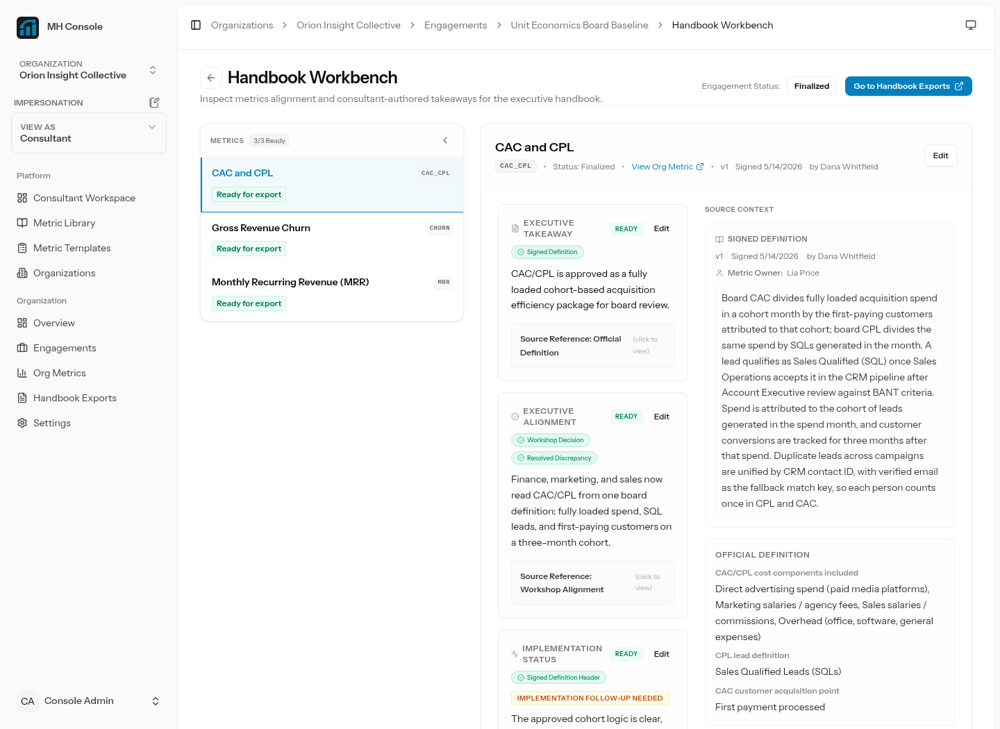

# Metric Harmony Console

Metric Harmony Console helps teams agree on how business metrics are defined and record those decisions in an executive handbook. This showcase follows a fictional SaaS company as its finance and growth teams align on recurring revenue, churn, and customer acquisition costs.



The consultant workbench keeps signed definitions, executive takeaways, and implementation gaps together. The [client handbook](docs/assets/showcase/handbook.png) gives stakeholders a focused view of the approved definitions. The [sample PDF](docs/assets/showcase/metric-handbook.pdf) includes the executive brief, approval history, and follow-up. All three use the same synthetic engagement. The PDF shows the application's standard confidentiality label.

## Run the static demo

The Vue demo opens on the MRR discrepancy for **Unit Economics Board Baseline**: Finance wants the month-end close snapshot, RevOps wants a rolling daily view. Choose a snapshot in Workshop, approve it in Handbook Workbench, and see the result in Client Handbook. The bundled PDF was rendered from the seeded month-end definition, so the handbook labels it **Sample PDF** whenever your approved choice differs. **Start over** clears the current decision. Data comes from `GoldenPathExecutiveArtifactStorySeeder` (see `demo/src/data/goldenPath.ts`).

From the repository root, use Node.js 20.19+ on the 20.x line or Node.js 22.12+ and npm:

```bash
npm ci --prefix demo
npm run dev --prefix demo
```

Open the local URL printed by Vite. To build and preview the production bundle:

```bash
npm run build --prefix demo
npm run preview --prefix demo
```

Serve the contents of `demo/dist/` on any static host at the site root or under a subdirectory. The bundle includes the sample PDF and requires no Laravel runtime, database, or login.

With Google Chrome installed, the end-to-end browser check builds the bundle, serves `demo/dist/` from a plain static server under a subdirectory, and covers both MRR choices, approval, handbook publication, PDF labeling, persistence, mobile layout, and **Start over**:

```bash
npm run test:browser --prefix demo
```

If Chrome is elsewhere, set `CHROME_PATH`. Without Chrome, download a headless build into the ignored `demo/.browser-check/` folder first:

```bash
cd demo && npx @puppeteer/browsers install chrome-headless-shell@stable --path .browser-check
```

Screenshots of each step are written to `demo/.browser-check/screenshots/`.

## Run the full Laravel showcase

Use PHP 8.5 with SQLite support, Composer, Node.js 22 or newer, and npm. Chrome or Chromium is needed to render a new PDF. The seeded views and bundled sample work without external service credentials.

Run these commands from a fresh clone in a POSIX shell:

```bash
composer install
npm ci
cp .env.example .env
touch database/database.sqlite
php artisan key:generate
php artisan migrate --seed
npm run build
APP_URL=http://127.0.0.1:8000 DEBUGBAR_ENABLED=false php artisan serve --host=127.0.0.1
```

Visit `http://127.0.0.1:8000`. These accounts are for the local seeded demo and share the password `password`.

| View | Account | Where to go |
| --- | --- | --- |
| Client | `nora.kim.golden@orion.test` | Open **Handbook** and select **Unit Economics Board Baseline**. |
| Consultant | `admin@e.test` | Open **Organizations → Orion Insight Collective → Engagements → Unit Economics Board Baseline → Handbook Workbench**. |

To render a fresh PDF from the demo data, set `LARAVEL_PDF_CHROME_BINARY` in `.env` if Chrome is installed outside the default search paths, then run:

```bash
php artisan dev:render-handbook-pdf --org-slug=orion-golden-path --output=tmp/metric-handbook.pdf
```

For the queued export flow, start `php artisan queue:work --queue=exports,default` in another terminal before clicking **Download Handbook**.

## Explore the implementation

- [Domain model](docs/specs/domain-model.md) and [access rules](docs/specs/rbac-workflow-spec.md) describe the organization and engagement boundaries.
- [Handbook workbench](resources/js/pages/Engagements/HandbookWorkbench.vue), [export payload](app/Actions/Handbook/BuildHandbookExportPayload.php), and [demo seed](database/seeders/StorySeeds/GoldenPathExecutiveArtifactStorySeeder.php) show the flow from stored decisions to export.
- [AI alignment case study](docs/ai-alignment-case-study.md) walks through a structured draft, the validation contract, and a failure caught in manual review.
- [Project conventions](docs/README.md) link to additional implementation notes and metric form examples.

Run `php artisan test` and `npm run test` for the backend and frontend suites.

## Source availability

This source is published for portfolio review. Third-party assets retain their own terms. The bundled Inter fonts are distributed under the [SIL Open Font License](public/fonts/OFL-Inter.txt).
