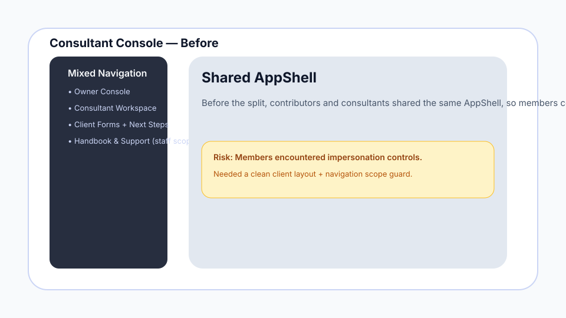
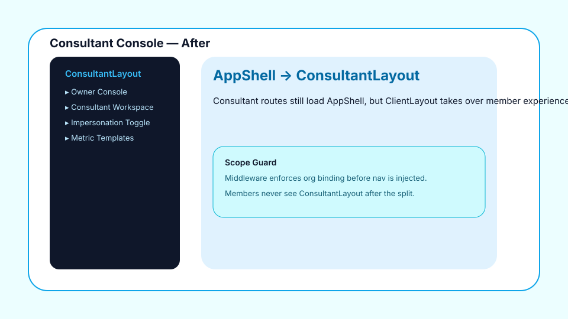
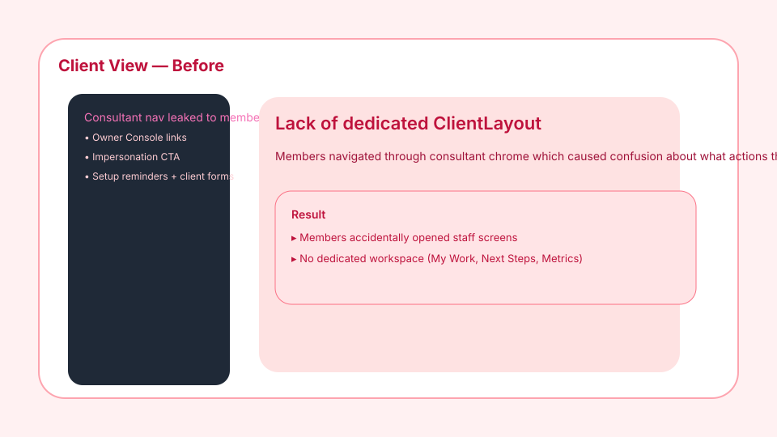
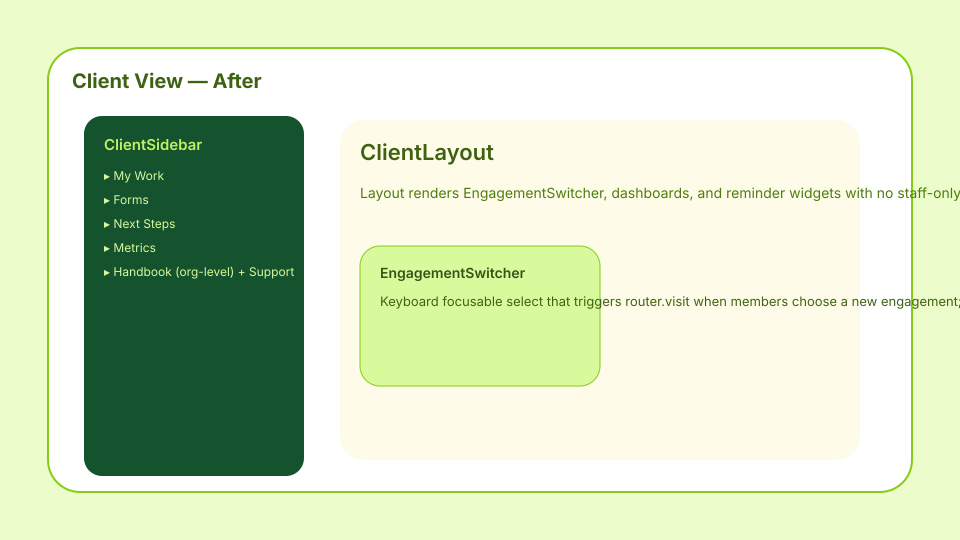

Audience: Engineer

# Memberships, Pending Invites, and Participants

This is the engineer’s guide to how memberships, invites, and engagement participants stay consistent from org creation through invite acceptance.

## What this covers
- Org creation and member ingestion
- Pending membership (invite) data model
- Participants and metric assignment behavior
- Invite acceptance safeguards
- Invariants to keep stable
- Where to find verifying tests

## Org creation and member ingestion
- `OrganizationController::store` normalizes the `members[]` payload.
- Internal staff creators are not attached as ordinary client memberships during org creation; access comes from staff authority unless explicit client collaborators are seeded.
- Org creation role options follow staff authority: `staff owner` may seed `owner`, while `staff admin` may seed only `admin`, `member`, or `viewer`.
- If an email belongs to an existing `User`, it creates a `Membership` immediately (via `MembershipRoleManager`).
- New emails become `PendingMembership` rows so the org overview shows only active memberships.
- Bootstrap helpers (`php artisan console:bootstrap`, `DatabaseSeeder`, `ProductionBootstrapSeeder`) create staff memberships directly (`firstOrCreate`) to keep internal org setup fast.

## Pending membership (invite) model
- Table: `pending_memberships` with `organization_id`, normalized `email`, optional `name`, selected `role`, `inviter_id`, timestamps.
- Uniqueness: `(organization_id, email)` prevents duplicate invites.
- Model: `PendingMembership` casts `role` to the `MembershipRole` enum and exposes helpers reused by controllers and APIs so all invite paths behave the same.

## Participants and metric assignments
- `EngagementController` creates `EngagementParticipant` rows for both active members and pending invites.
- Each participant points to either `membership_id` or `pending_membership_id` (never both).
- `MetricParticipant` points at the engagement participant and stores role (`Contributor`, `Approver`, `Observer`).
- Contributors/Approvers spawn `FormAssignment` placeholders and optional `FormSubmission` drafts; Observers are informational.
- While an invite is pending, assignments keep the `PendingMembership` pointer. On acceptance, the system swaps to the real `Membership` and replays assignment creation to ensure parity.

## Invite acceptance and safeguards
- `PendingMembershipAcceptanceController` enforces signed links, throttling (`throttle:5,1`), email matching, owner transfer demotions, logging, and job enqueues that backfill assignments.
- After acceptance, it deletes the pending row and ensures all `FormAssignment` records point at a real membership.
- Internal organization `MEMBER` invites create `staff operator` authority and redirect to `profile.edit` as a safe consultant-plane empty state instead of falling through to `/client/*`.

## Invariants (must hold)
- I‑1: `(organization_id, email)` unique in `pending_memberships` (prevents duplicate invites).
- I‑2: `EngagementParticipant` uses either `membership_id` or `pending_membership_id` (mutually exclusive).
- I‑3: Ownership changes flow through invites; acceptance demotes any other owners so there is only one owner.
- I‑4: Participant pickers show only active `memberships`; pending invites are not selectable until acceptance.

## Failure‑path tests (verify)
- `tests/Feature/PendingMembershipAcceptanceTest.php` — blocks mismatched emails, enforces throttling, demotes owners, deletes pending rows.
- `tests/Feature/Engagement/PendingInvitationMetricsTest.php` — assignments survive invite revoke/reassign.
- `tests/Feature/Engagement/ShowTest.php`, `tests/Feature/Engagement/StakeholderAssignmentsTest.php` — enforce selection constraints.

## Cross-links
- Human version: [docs/guides/memberships-and-invites.md](../guides/memberships-and-invites.md)

## Console split and route boundaries

### Layout selection and props
- `resources/js/layouts/AppLayout.vue` now decides between `ConsultantLayout` and `ClientLayout` instead of forcing every user through `AppShell`.
- Internal staff accounts (`auth.user.is_internal_staff`) and anyone impersonating an org (`impersonation.organization`) always get `ConsultantLayout`, which preserves the existing sidebar, Owner Console routes, and impersonation toggles.
- Members (non-staff, not impersonating) render `ClientLayout`, which mounts `ClientSidebar.vue`, `EngagementSwitcher.vue`, and client-specific top chrome so contributors never see the staff-only Wayfinder links.
- `AppLayout` forwards breadcrumbs only to the consultant view; `ClientLayout` intentionally hides staff breadcrumbs to keep the client handbook focused.

### Client routing and middleware
- `routes/client.php` is registered via `RouteServiceProvider` and carries the `client` middleware alias (see `app/Http/Middleware/EnsureClientContext.php`).
- Requests hitting `/client/*` must be authenticated + verified and either (a) a member of the targeted non-internal organization or (b) an internal staff user actively impersonating that org. `EnsureClientContext` now both rejects `is_internal = true` route/active-org context and keys impersonation checks off `isInternalStaff()`, so `staff operator` requires impersonation and an internal-only `VIEWER` membership does not open client routes.
- Feature tests in `tests/Feature/Client/DashboardTest.php` and `tests/Feature/Client/RouteAccessTest.php` assert the middleware behavior (403 for staff without impersonation, pass-through for members/impersonators).

### Navigation payloads
- `app/Http/Middleware/HandleInertiaRequests.php` hydrates `clientNavigation` only for non-internal member context or an active impersonation session. Internal organizations are filtered out of `activeOrganizationId` fallback resolution so shared props do not leak the staff workspace into client-plane UI.
- `app/Http/Middleware/HandleInertiaRequests.php` also includes `clientNavigation.handbookMetrics`, a list of finalized org metrics derived from the official selection logic for the sidebar.
- `resources/js/composables/useClientNav.ts` derives workspace links (handbook, support; metrics remains null) and resolves `handbookMetrics` items so `ClientSidebar.vue` can render the finalized list. The Forms shortcut is removed; `/client/forms` remains reachable by direct URL.
- The engagement select honors the persisted engagement cookie; switching engagements updates the cookie and triggers an Inertia visit so forms/metrics views stay scoped. Handbook exports and history remain org-level and should ignore the engagement selection.

### Release artifacts (before/after views)
- Screenshot-ready SVGs documenting the split live under `docs/assets/console-split/`. Embed them in release decks or attach to PR threads:
  - 
  - 
  - 
  - 
- Re-generate captures by running `npm run dev`, logging in as staff (for the consultant view) and as a member (for the client view), then exporting updated SVG/PNG files into the same directory so release managers can drop them into launch comms.
